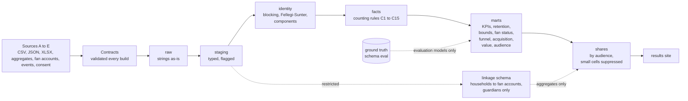

# Counting Flag Football

**[Results site](site/index.html)** (built by `make site`; CI publishes it to GitHub Pages) · [Participation memo](docs/methodology/counting-a-participant.md) · [Fan-acquisition memo](docs/methodology/flag-as-fan-acquisition.md) · [Decisions](docs/decisions/) · [Demo script](docs/demo_script.md) · [UI spec](ui-spec.md)

**How many fans does flag football create, how engaged and valuable are they, and how many can we contact?** This is a governed data platform for a **synthetic** global flag football
program that answers that question, and then shows how sure it is: the fans the programme added (an estimate with an interval, next to the naive count that is more than twice too big), what a fan
is worth, and how much of the engaged audience governance lets the organisation talk to. It started as "how many people play" and still answers that too. Five messy sources (a league CSV, a club API,
a federation workbook, school headcounts and a fan feed) go in; every claim is graded against an answer key the generator keeps. Python generates and loads; **SQL (dbt on DuckDB) is the showcase**.

**Status:** all 13 steps of the fan-acquisition rework are built; methodology **v2.0** (25 scorecard KPIs) is published for 2021 to 2025 and the restatement log is empty. The two methodology memos and the demo talking points are drafts for the owner to write, and the CI workflow has not yet run (no GitHub remote). The results site has six pages (overview, acquisition, value, audience, participation, trust) plus an appendix, a drive chart on the Acquisition page, and an original project mark; a build check refuses any image file, ``, foreign inline SVG or foreign favicon, so no third-party logo can ship. [`fix-list.md`](fix-list.md) tracks what remains (the generator-side items are open).

> ## All data in this project is synthetic
> Every person, email and phone number is fake, generated from a fixed seed (42). The real equivalent is **minors' personal information**: children aged 5 to 17, their
> guardians' contact details, photo and marketing consent. That is why the project uses invented people: the modelling, privacy and governance patterns can be shown in public
> without exposing a real child. Every number below describes a generated population, not a real program.

## Architecture



## Results (synthetic data, 2021 to 2025; latest period shown)

| What | Result |
|---|---|
| **Fan accounts the programme added** (incremental, stacked market-launch comparison) | **1,264** (95% interval 897 to 1,630); truth 1,111. The naive count of net-new households is 939 linked (0.85x the truth) and 2,543 scaled by the link rate (**2.3x**) |
| **Addressable audience** (guardian opted in on at least one channel, December 2025) | **3,511 of 13,043** registered households (email 2,107, SMS 1,231, push 1,748; channels overlap) |
| **Consent gap** (active households with no opt-in at all) | **803 households, about 25% of the active**, worth about 96,360 in synthetic currency at the median monetized household's spend (an opportunity size, not revenue) |
| Fan lifetime value (36-month horizon, synthetic currency) | existing fans 387 (381 to 393), net-new 368 to 372 (352 to 386); 12-month survival 95% for existing fans, 89% for net-new |
| Value uplift after registering a child (existing fans) | +0.21 events per household-month (truth +0.18); net spend up about 1.1 per household-month (synthetic currency) |
| Fan engagement uplift after first registration (linked households) | naive +17.5% (0.99x the truth), matched difference-in-differences +22.6% (truth +20.5%) |
| Markets (46 synthetic) | 15 retention-and-engagement, 8 program-growth, 3 acquisition white space, 20 long-term build |
| Unique registered participants | 8,959 in 2025 (identity range 8,921 to 8,976, a 0.6% band) |
| Identity resolution, final matcher (`fs`, automatic merges) | precision 99.81%, recall 99.99%; **9 sibling/twin false merges (a finding, not yet fixed: ADR-008)**; 14,991 predicted vs 15,000 true people |
| Rules baseline vs probabilistic | rules recall 92.7% (16,044 predicted people, no sibling merges); literal Fellegi-Sunter `fs_naive` makes 213 sibling merges; the corrected `fs` makes 9 |
| One-year retention of entrants (Kaplan-Meier, censored) | 72.2%; counting age-outs as churn would report 37% for entrants aged 14 to 17 (truth 61%) |
| Household link rate (registration to fan account) | 36% overall; email links 99.98% precise, phone links 85.8% (UNLINKED means unknown: about 23% of unlinked households do have an account) |

Counts are **registered participants in onboarded sources**, not total participation; fan results describe **households linked to a fan account**. Details and caveats: the
[participation memo](docs/methodology/counting-a-participant.md) and the [fan-acquisition memo](docs/methodology/flag-as-fan-acquisition.md) (both prose still being written), and the [results site](site/index.html).
Governance sets the size of the marketable audience: nothing linked reaches marketing or media, so the audience is published as counts only (ADR-009).

## Design decisions

| ADR | One line |
|---|---|
| [001 Stack](docs/decisions/ADR-001-stack.md) | dbt-duckdb, with every DuckDB-specific function logged so a Snowflake port is a list, not a hunt |
| [002 Age cutoff](docs/decisions/ADR-002-age-cutoff-convention.md) | Age is age on December 31 of the season year |
| [003 Identity resolution](docs/decisions/ADR-003-identity-resolution.md) | Blocking plus Fellegi-Sunter in SQL; precision first, because a sibling merge is a privacy incident |
| [004 Participant ID stability](docs/decisions/ADR-004-participant-id-stability.md) | IDs are derived and stable across rebuilds; a persisted registry is the production step |
| [005 Counting rules](docs/decisions/ADR-005-counting-rules.md) | Rules C1 to C15 define who counts, once, in which country, at what age |
| [006 Privacy controls](docs/decisions/ADR-006-privacy-controls.md) | Audience column policy, small-cell suppression, pseudonymization; pseudonymous is not anonymous |
| [007 Publish and restatement](docs/decisions/ADR-007-publish-and-restatement.md) | Immutable snapshots; a changed published number needs a cause, a threshold and an owner |
| [008 Phase 4 scope and findings](docs/decisions/ADR-008-phase-4-scope-and-findings.md) | Config-driven window, contracts and a playbook, aggregate-only sources, and what Phase 4 found |
| [009 Household linkage governance](docs/decisions/ADR-009-household-linkage-governance.md) | Linking registrations to fan accounts is a governance decision; restricted zone, aggregates out. Decided by Anna (2026-10-02) |
| [010 Fandom outcomes](docs/decisions/ADR-010-fandom-outcomes-design.md) | Matched difference-in-differences, designed before the truth was read and never tuned to it |
| [011 Acquisition measurement](docs/decisions/ADR-011-acquisition-measurement-design.md) | Fan acquisition is measured at market level from staggered launches: stacked cohort comparison against not-yet-treated markets, not a pooled two-way regression |

## Phase 5: data quality under privacy constraints

**How do you fix thin, messy youth participation data when privacy rules block the obvious fixes (collect more, buy enrichment, share more)?** The real pain point is that participation data is sparse and poor quality; consent is
not the bottleneck. Phase 5 tells one story through two lenses, built around **one club market end to end** (`make p5-demo`, talk track in [`docs/phase5-demo.md`](docs/phase5-demo.md)):

| Lens | Question | Where the answer is |
|---|---|---|
| **Privacy / compliance lead** | What do we collect and why; what is a consent worth; what never leaves the league; when is it deleted? | [data standard](docs/data-standard.md) (the fields we deliberately do not ask for), [consent provenance funnel](#phase-5-results), [retention job](docs/retention.md) |
| **Clubs / analytics lead** | What can I see and act on in my territory, and how far can I trust it? | [league and market scorecard with fix list](#phase-5-results), [market estimate with a confidence band](docs/market-estimate.md), the aggregate-only club views |

All data is **synthetic** and every claim about NFL, RCX, vendor or club systems is an **assumption**, labelled where it is made; legal points are open questions ([`docs/questions-for-stakeholders.md`](docs/questions-for-stakeholders.md)), never findings.
Phase 5 is an isolated scope: its feeds use their own random stream, so no Phase 1 to 4 file or published number changes ([ADR-012](docs/decisions/ADR-012-phase-5-scope-and-design.md)).

### The demo flow

1. **The mess.** Six registration feeds with different schemas and defects (`make p5-feeds`; every defect rate is in `config/generation.yaml` under `phase5`).
2. **Resolution.** The Phase 2 identity engine, reused (its macros and rules, one extension for feeds with no date of birth), takes about 16,000 registrations to 7,657 children.
3. **Scorecard.** Every league and market graded on six dimensions and fit for two purposes. *Pause for the clubs lead: "here is what you can trust."*
4. **Consent provenance funnel.** Where households drop out, and why. *Pause for the privacy lead: "here is what never leaves the league, and here is the deletion job."*
5. **Market estimate.** Participation rate with a confidence band, against a labelled synthetic stub of the Census youth population. No data about children is bought.
6. **Data standard.** The one-page ask to league operators that improves the next season: less data for privacy, cleaner data for analytics.

### The six feeds (assumed shapes)

| Feed | Shape | Defects injected on purpose |
|---|---|---|
| `matrix_export` | cleanest: league id, DOB, parent email, ZIP, consent version and timestamp | missing ZIP, ZIP+4, consent timestamp or version missing, no consent record, stale leagues |
| `vendor_reg_a` | third-party platform: free-text league name, DOB as text | league name variants (85% in the alias map), four DOB formats, impossible DOB, invalid or missing ZIP |
| `vendor_reg_b` | age group only (`U10`), combined parent name | no birth year, invalid or missing ZIP, no consent record |
| `pop_warner_feed` | association-centric, tackle and flag mixed | tackle rows to filter; an association is not a league; waiver only, no consent evidence |
| `pal_chapter_csv` | manual spreadsheet uploads | blank columns, typos, duplicated rows, two-digit-year DOBs, consent in five wordings or none |
| `school_program` | roster only: school, grade, name | no parent contact, no ZIP, no DOB |

Across feeds: the same child in two feeds with name variants, parent emails shared by siblings, some families using two, late submissions, and leagues that never sent their latest season (seasons 2024 and 2025; the Phase 1 to 4 window is not extended).

### Phase 5 results

*Synthetic data. Run `make p5-score` to print all of it; `make p5-minimization` and `make p5-retention` for the other two.*

**Scorecard.** Rules are rows in the `p5_dq_rules` seed (id, dimension, description, SQL, a threshold per purpose, fix text), evaluated by one macro, so they are auditable. Every `matrix_export` league is fit for participation
reporting but only 3 of 26 are fit for club activation, because consent timestamps and wording versions are missing; school rosters score D. `dq_fix_list` gives each league its top three actionable issues.

**Consent provenance funnel.** A household is a set of parent emails joined by the children they share; consent is recorded against the household, never the child, and a test fails the build if anything downstream of it can be
joined back to a child. A consent email is not a marketing opt-in.

| Stage | Count | Why it drops |
|---|---|---|
| Participants (resolved children) | 7,657 | (true children: 6,624; the gap is the recall limit of matching) |
| Children in a contactable household | 6,771 | no usable parent email (school rosters, blank or malformed) |
| Resolved households | 5,430 | siblings share a parent email |
| **Households with known consent provenance** | **3,261** | consent missing, or recorded with no timestamp or wording: **the data quality story** |
| **Households eligible for club activation** | **638** | no marketing opt-in captured (1,827), declined (2,249), opt-in without wording (485) or timestamp (70), consent later revoked (161): **the privacy story** |

Treating league-communications consent as a marketing opt-in would have admitted 2,258 more households (78% of those who agreed to league emails); 1,781 of them never opted in to marketing. Against the answer key: 0 falsely eligible
households; household grouping precision 1.0, recall 0.94.

**Data standard** ([`docs/data-standard.md`](docs/data-standard.md)). 16 fields, each with purposes and a retention rule, plus the fields deliberately *not* asked for (full date of birth, ZIP5, child contact details, parent name,
tackle registrations). Asking for birth year and ZIP3 instead of full DOB and ZIP5 costs about four points of recall (0.866 to 0.827) and no precision. Only `US_LEAGUE` meets the core fields today and no source meets the consent fields; `validate_against_standard` validates any new one.

**Market estimate** ([`docs/market-estimate.md`](docs/market-estimate.md)). Children are placed by ZIP3 into a market and a market into a synthetic club territory, with shared markets and areas with no club handled on purpose;
children with no usable ZIP are allocated by where placed children of the same league live. The club-facing schema `phase5_club` is aggregate only with a minimum cell size of 10 and a test that fails the build otherwise.
**Honest result:** the point estimate overshoots (about 8% mean error, 5% for the naive count) because the matcher misses some duplicates; the first band contained the truth in 9 of 20 markets, and the revised band's 20 of 20 was
designed after seeing that, so it is not evidence (ADR-012).

**Retention** ([`docs/retention.md`](docs/retention.md)). A real job on a retention-managed copy, never on `raw`, `eval` or the published snapshots: revoked households leave every eligible set at once; child-level records go when a child
ages out (Dec 31 of the year they turn 18, plus a grace period) or a registration passes a maximum age; aggregates are kept; a household with no child left loses its parent contact data; a revoked email leaves only a hash. The log
holds counts only. Six invariants are re-checked in independent SQL and the build fails if anything over the threshold survives. Every period is an assumption (the actual one is an open question).

**Known finding.** Phase 5 matching still makes 3 sibling false-merge pairs (two same-named children in one household, one with an unreadable date of birth). A sibling merge is a privacy incident by project rules, so it is reported, not hidden.

## If this were real

- **Snowflake and dbt Cloud.** The dbt is written to be portable (DuckDB-only functions are listed in ADR-001); real warehouse roles would replace the policy that a build check enforces.
- **Orchestration.** Scheduled loads, freshness checks and alerting; today everything runs from `make`.
- **Partner contracts as a governance process.** A contract here is a YAML file validated on every build; a real one is signed with the partner, owned by a named role and renegotiated when the data changes (see the [playbook](docs/playbook/onboard-a-source.md)).
- **A persisted participant-ID registry.** IDs here are derived; production needs a registry so that a merge or split is an event, not a rebuild (ADR-004).
- **Real access control.** Column policies per audience, with database roles, audit logging and an access review (ADR-006).
- **Real market launches are not random.** Markets here launch in an order unrelated to their fan potential, which is what makes the incrementality estimate credible; real launches target promising markets, so ADR-011's comparison would need pre-trends per market and a sensitivity analysis.
- **Attendance data.** A registration is not proof someone played. Counting attendance would change every definition here.
- **Real data would score lower.** The synthetic population has phone numbers that never change and one nickname list; identity resolution on real data is harder, and the truth column would not exist.

## Run it

Requires [`uv`](https://docs.astral.sh/uv/) and `make`. Python 3.12 is fetched automatically. pytest runs on four workers; the CI job allows 25 minutes.

```bash
make setup        # install dependencies, create dbt/profiles.yml from the example
make all-phases   # the supported full build, from an empty checkout: about 8 minutes, most of it the test suite
make site         # build the results site into site/
python3 -m http.server 8000 -d site   # then open http://localhost:8000
```

`make all-phases` generates the data, loads raw, ground truth and published snapshots, validates the contracts, runs every dbt model and test, runs pytest, and runs the build
checks: ground-truth isolation, aggregate lineage, share policy and participant-ID stability. Any failure stops it.

| Command | What it does |
|---|---|
| `make generate` / `make load` / `make load-eval` | write the synthetic files; land them in `raw`; load the quarantined ground truth into `eval` |
| `make contracts` | validate every source contract against the raw tables (an `ERROR` fails the build) |
| `make fan-status` / `make funnel` / `make acquisition` / `make fan-value` / `make audience` | run one fan analysis and print its comparison with the truth (also `make retention`, `make linkage`, `make fan`) |
| `make docs` | regenerate the data dictionary, metric catalog and access policy |
| `make publish YEAR=2025` | write an immutable snapshot of that year's scorecard under the current methodology version (refuses unless every test passes, about 5 minutes per year; never part of `all-phases`) |
| `make site` | build the results site from `scripts/build_site.py` and `site_src/` (templates, styles, JS); fails if a chart would compute a number in the browser, or if the site contains an image or an SVG that is not the project's own |

Explore `warehouse/flag.duckdb`:

```sql
select * from share_exec.share_exec__participation_bounds;       -- the headline with identity bounds
select * from quality.dq_summary;                                -- observed vs configured defect rates
select * from retention.mart_retention_survival;                 -- Kaplan-Meier with Greenwood intervals
select * from evaluation.eval_acquisition;                       -- incremental vs naive vs truth
select * from share_exec.share_exec__addressable_audience;       -- audience and consent gap (counts only)
```

## Principles

1. **SQL is the showcase.** Python generates and loads; cleaning, counting, matching and analysis are SQL.
2. **Raw is immutable.** Strings in, strings stored.
3. **Deterministic.** One seed; two clones produce byte-identical files.
4. **Messiness is specified.** Defects are injected at exact counts, so detection can be checked.
5. **Ground truth is quarantined.** It lives in schema `eval` and is read only by `models/evaluation/`; a build check enforces it.
6. **Never guess.** Ambiguity becomes NULL or `U` and is flagged. Consent not captured is NULL, never FALSE.
7. **Say how sure you are.** Identity bounds, censoring, confidence intervals, and a comparison with the naive answer next to every estimate.
8. **Never tune to the truth.** Estimator designs are fixed before the answer key is read; where an estimate misses, the result says so (ADR-010, ADR-011).
9. **Guardians only, and never to marketing.** Every fan account holder is an adult; household-linked data leaves the restricted zone only as suppressed aggregates, and nothing linked reaches marketing or media (ADR-009). Unlinked means unknown, not non-fan.

## Documents

[Participation memo](docs/methodology/counting-a-participant.md) · [Fan-acquisition memo](docs/methodology/flag-as-fan-acquisition.md) · [Changelog](docs/methodology/CHANGELOG.md) · [Metric catalog](docs/metrics.md) · [Access policy](docs/access_policy.md) ·
[Data dictionary](docs/data_dictionary.md) · [Source inventory](docs/source_inventory.md) · [Onboarding playbook](docs/playbook/onboard-a-source.md) ·
[Restatement examples](docs/reports/restatement_demo.md) · [Earlier build notes (phases 1 to 3)](docs/build_notes_phases_1_to_3.md) ·
[Phase 5: data standard](docs/data-standard.md) · [market estimate](docs/market-estimate.md) · [retention](docs/retention.md) · [demo](docs/phase5-demo.md) · [questions for stakeholders](docs/questions-for-stakeholders.md)
