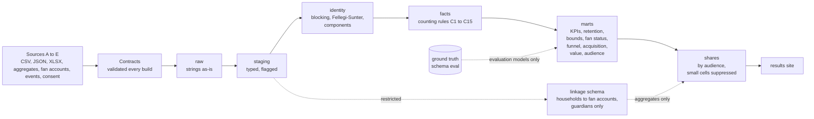

# Flag Football Project

**Live site:** https://counting-flag-football.onrender.com (synthetic data only; built from `public/`)

**[Results site](site/index.html)** (built by `make site`; CI publishes it to GitHub Pages) · [Participation memo](docs/methodology/counting-a-participant.md) · [Fan-acquisition memo](docs/methodology/flag-as-fan-acquisition.md) · [Decisions](docs/decisions/) · [Demo script](docs/demo_script.md) · [UI spec](ui-spec.md)

**How many fans does flag football create, how engaged and valuable are they, and how many can we contact?** This is a governed data platform for a **synthetic** global flag football
program that answers that question, and then shows how sure it is: the fans the programme added (an estimate with an interval, next to the naive count that is more than twice too big), what a fan
is worth, and how much of the engaged audience governance lets the organisation talk to. It started as "how many people play" and still answers that too. Five messy sources (a league CSV, a club API,
a federation workbook, school headcounts and a fan feed) go in; every claim is graded against an answer key the generator keeps. Python generates and loads; **SQL (dbt on DuckDB) is the showcase**.

**Status:** all 13 steps of the fan-acquisition rework are built; methodology **v2.0** (25 scorecard KPIs) is published for 2021 to 2025 and the restatement log is empty. The two methodology memos and the demo talking points are drafts for the owner to write, and the CI workflow has not yet run (no GitHub remote). The results site has six pages (overview, acquisition, value, audience, participation, trust) plus an appendix, a drive chart on the Acquisition page, and an original project mark; a build check refuses any image file, ``, foreign inline SVG or foreign favicon, so no third-party logo can ship. [`fix-list.md`](fix-list.md) tracks what remains (the generator-side items are open).

> ## All data in this project is synthetic
> Every person, email and phone number is fake, generated from a fixed seed (42). The real equivalent is **minors' personal information**: children aged 5 to 17, their
> guardians' contact details, photo and marketing consent. That is why the project uses invented people: the modelling, privacy and governance patterns can be shown in public
> without exposing a real child. Every number below describes a generated population, not a real program.

## Architecture



## Results (synthetic data, 2021 to 2025; latest period shown)

| What | Result |
|---|---|
| **Fan accounts the programme added** (incremental, stacked market-launch comparison) | **1,264** (95% interval 897 to 1,630); truth 1,111. The naive count of net-new households is 939 linked (0.85x the truth) and 2,543 scaled by the link rate (**2.3x**) |
| **Addressable audience** (guardian opted in on at least one channel, December 2025) | **3,511 of 13,043** registered households (email 2,107, SMS 1,231, push 1,748; channels overlap) |
| **Consent gap** (active households with no opt-in at all) | **803 households, about 25% of the active**, worth about 96,360 in synthetic currency at the median monetized household's spend (an opportunity size, not revenue) |
| Fan lifetime value (36-month horizon, synthetic currency) | existing fans 387 (381 to 393), net-new 368 to 372 (352 to 386); 12-month survival 95% for existing fans, 89% for net-new |
| Value uplift after registering a child (existing fans) | +0.21 events per household-month (truth +0.18); net spend up about 1.1 per household-month (synthetic currency) |
| Fan engagement uplift after first registration (linked households) | naive +17.5% (0.99x the truth), matched difference-in-differences +22.6% (truth +20.5%) |
| Markets (46 synthetic) | 15 retention-and-engagement, 8 program-growth, 3 acquisition white space, 20 long-term build |
| Unique registered participants | 8,959 in 2025 (identity range 8,921 to 8,976, a 0.6% band) |
| Identity resolution, final matcher (`fs`, automatic merges) | precision 99.81%, recall 99.99%; **9 sibling/twin false merges (a finding, not yet fixed: ADR-008)**; 14,991 predicted vs 15,000 true people |
| Rules baseline vs probabilistic | rules recall 92.7% (16,044 predicted people, no sibling merges); literal Fellegi-Sunter `fs_naive` makes 213 sibling merges; the corrected `fs` makes 9 |
| One-year retention of entrants (Kaplan-Meier, censored) | 72.2%; counting age-outs as churn would report 37% for entrants aged 14 to 17 (truth 61%) |
| Household link rate (registration to fan account) | 36% overall; email links 99.98% precise, phone links 85.8% (UNLINKED means unknown: about 23% of unlinked households do have an account) |

Counts are **registered participants in onboarded sources**, not total participation; fan results describe **households linked to a fan account**. Details and caveats: the
[participation memo](docs/methodology/counting-a-participant.md) and the [fan-acquisition memo](docs/methodology/flag-as-fan-acquisition.md) (both prose still being written), and the [results site](site/index.html).
Governance sets the size of the marketable audience: nothing linked reaches marketing or media, so the audience is published as counts only (ADR-009).

## Design decisions

| ADR | One line |
|---|---|
| [001 Stack](docs/decisions/ADR-001-stack.md) | dbt-duckdb, with every DuckDB-specific function logged so a Snowflake port is a list, not a hunt |
| [002 Age cutoff](docs/decisions/ADR-002-age-cutoff-convention.md) | Age is age on December 31 of the season year |
| [003 Identity resolution](docs/decisions/ADR-003-identity-resolution.md) | Blocking plus Fellegi-Sunter in SQL; precision first, because a sibling merge is a privacy incident |
| [004 Participant ID stability](docs/decisions/ADR-004-participant-id-stability.md) | IDs are derived and stable across rebuilds; a persisted registry is the production step |
| [005 Counting rules](docs/decisions/ADR-005-counting-rules.md) | Rules C1 to C15 define who counts, once, in which country, at what age |
| [006 Privacy controls](docs/decisions/ADR-006-privacy-controls.md) | Audience column policy, small-cell suppression, pseudonymization; pseudonymous is not anonymous |
| [007 Publish and restatement](docs/decisions/ADR-007-publish-and-restatement.md) | Immutable snapshots; a changed published number needs a cause, a threshold and an owner |
| [008 Phase 4 scope and findings](docs/decisions/ADR-008-phase-4-scope-and-findings.md) | Config-driven window, contracts and a playbook, aggregate-only sources, and what Phase 4 found |
| [009 Household linkage governance](docs/decisions/ADR-009-household-linkage-governance.md) | Linking registrations to fan accounts is a governance decision; restricted zone, aggregates out. Decided by Anna (2026-10-02) |
| [010 Fandom outcomes](docs/decisions/ADR-010-fandom-outcomes-design.md) | Matched difference-in-differences, designed before the truth was read and never tuned to it |
| [011 Acquisition measurement](docs/decisions/ADR-011-acquisition-measurement-design.md) | Fan acquisition is measured at market level from staggered launches: stacked cohort comparison against not-yet-treated markets, not a pooled two-way regression |
| [012 Phase 5 scope and design (v1)](docs/decisions/ADR-012-phase-5-scope-and-design.md) | The first build of Phase 5, from the handover; superseded in part by ADR-013 |
| [013 Phase 5 reconciliation](docs/decisions/ADR-013-phase5-reconciliation.md) | How v1 was reconciled with the larger spec: keep, merge, rename or retire, with the defaults taken |
| [014 Rule registry and scoring](docs/decisions/ADR-014-dq-rule-registry-and-scoring.md) | One rule registry; a purpose score is the minimum of its dimensions; Wilson intervals for small organizations |
| [015 Uncertainty decomposition](docs/decisions/ADR-015-uncertainty-decomposition.md) | Identity, data-quality exclusions and coverage side by side, never added; what the evaluation found |
| [016 Club-market mapping](docs/decisions/ADR-016-club-market-mapping.md) | A project approximation of club markets over ZIP3, shared-market weights, no invented denominators |
| [017 Retention versus deletion](docs/decisions/ADR-017-retention-vs-deletion.md) | Age-out deletion in the identity and linkage zones; what analytics survive |
| [018 Minimization and the data standard](docs/decisions/ADR-018-minimization-and-data-standard.md) | The measured frontier of five variants; the data standard cites V2 (birth year, ZIP3), chosen by Anna |
| [019 Consent provenance and the activation funnel](docs/decisions/ADR-019-consent-provenance-and-activation-funnel.md) | Household-keyed consent events, provenance grades, losses split into data quality and privacy |
| [020 Site viewer and plain-language copy](docs/decisions/ADR-020-site-viewer-and-copy.md) | Cards and a full-screen viewer, copy rules and checks, a league belongs to one market, the open control-limit and market-name choices |
| [021 Data product portfolio](docs/decisions/ADR-021-data-product-portfolio.md) | Three goals become five data products; the MVP (US growth with intake first); the one canonical uplift metric; what happens to the older Acquisition, Value and Audience pages |
| [022 Age tiers and guardian consent](docs/decisions/ADR-022-age-tiers-and-guardian-consent.md) | Four age tiers, guardian-only for every minor, the strictest-standard default, and the youth-to-adult step that is not measurable by design |

## Phase 5: data quality under privacy constraints

**How do you fix thin, messy youth participation data when privacy rules block the obvious fixes (collect more, buy enrichment, share more)?** The real pain point is that participation data is sparse and poor quality; consent is
not the bottleneck. Phase 5 tells one story through two lenses, built around **one club market end to end** (`make p5-demo`; the 15-minute two-audience path is in [`docs/demo_script.md`](docs/demo_script.md); the site has four new pages, each with a Club lens / Privacy lens toggle; every chart is a small card that opens in a full-screen viewer you can scroll or arrow through, and `page.html#view=Q3-2` links to a slide. Terms are explained in the [glossary](site/glossary.html); `make site-check` runs the layout and plain-language checks, [ADR-020](docs/decisions/ADR-020-site-viewer-and-copy.md)):

| Lens | Question | Where the answer is |
|---|---|---|
| **Privacy / compliance lead** | What do we collect and why; what is a consent worth; what never leaves the league; when is it deleted? | [data standard](docs/data-standard.md), [consent provenance and the activation funnel](docs/decisions/ADR-019-consent-provenance-and-activation-funnel.md), [minimization frontier](docs/decisions/ADR-018-minimization-and-data-standard.md), [retention versus deletion](docs/decisions/ADR-017-retention-vs-deletion.md) |
| **Clubs / analytics lead** | What can I see and act on in my market, and how far can I trust it? | [data quality explained](docs/data-quality.md), the purpose scorecards and fix lists (`make dq`), the club-market view ([ADR-016](docs/decisions/ADR-016-club-market-mapping.md)), `share_club` |

All data is **synthetic**, and every claim about NFL, RCX, vendor or club systems is an **assumption**, labelled where it is made ([real-world context](docs/context/real-world-context.md)); legal points are open questions ([`docs/questions-for-stakeholders.md`](docs/questions-for-stakeholders.md)), never findings. The decisions are ADR-013 to ADR-022; ADR-013 records how the first build (v1, from the handover) was reconciled with the larger spec.

### What was built
- **Structured defects.** Organizations get latent quality profiles (35% disciplined, 45% typical, 15% struggling, 5% manual), fields go missing for reasons that depend on who registers (not at random), 15 to 25% of known organizations send no file in a season, and consent wording comes in four versions. Counting rules and KPI definitions are unchanged.
- **One rule registry.** 141 rules (the original flags, the data-contract rules, the data standard, and Phase 5 rules) are rows of `dq_rule_registry`, scored per purpose (count, segment, geography, retain, activate); a purpose score is the *minimum* of its dimension scores, and small organizations carry a Wilson interval ([ADR-014](docs/decisions/ADR-014-dq-rule-registry-and-scoring.md)).
- **The nuance layer.** The participant count has three uncertainties shown side by side and never added (identity, data-quality exclusions, coverage), and missingness comes with Manski bounds and tests ([ADR-015](docs/decisions/ADR-015-uncertainty-decomposition.md)).
- **Consent provenance and the activation funnel**, with each loss typed DQ or PRIVACY. **Club markets**: 32 project-approximation markets over ZIP3, allocated counts, no invented denominators.
- **Minimization frontier, retention versus deletion, the club and privacy shares, a simulated fix-list payoff**, and four site pages.

### Phase 5 results (synthetic; each is reproducible from `make`)
- **The scorecard separates the worst profile from the rest, but barely the middle.** MANUAL organizations score 15 for activation against 62 to 63 for the others, and 56 for retention against 90 to 99; STRUGGLING is hard to tell from TYPICAL without labels (`eval_scorecard_vs_profile`). Every organization-based source caps near 78 under the minimum rule because organizations that sent late or no files pull timeliness down.
- **Identity bounds held; the coverage estimate only partly.** In all five years the identity interval contains the true number of people in the data. The coverage interval (the estimate for organizations that sent no file) contains the truth in 3 of 5 years, with point errors from -7% to +31%. It was not tuned after seeing this.
- **Missing gender is biased, not just sparse.** Blank genders concentrate in the youngest divisions and in spreadsheet files; the girls' share bounds are narrow at participant level (0.5% unknown) and the verdict is "not missing at random".
- **Consent: most recorded opt-ins are not evidence of the purpose.** 71% of recorded marketing opt-ins are on a form whose wording never names club marketing. In 2025, of 6,791 households 544 are consenting with full provenance; the loss to consent is 3,480 PRIVACY (declined or revoked) and 1,420 data quality. Of the 3,052 contacts on the Phase 3 marketing list, 495 match a fully evidenced consent (reported, not changed; question 14).
- **Minimization: dropping the day of birth and ZIP5 costs the matcher almost nothing here.** Uniqueness falls from 99% to 57% of participant-years and sibling/twin merges from 7 to 1 (one synthetic dataset). Dropping the phone costs accuracy; hashing the email costs the whole activation purpose. No variant reaches `k_min`. The data standard cites **V2** (birth year, ZIP3; chosen by Anna) ([ADR-018](docs/decisions/ADR-018-minimization-and-data-standard.md)).
- **Deletion: the retention marts survive if the pseudonymous key is kept.** Rebuilt from anonymized facts they are unchanged; if identity resolution is re-run on the anonymized inputs, participants inflate 15% and retention falls about 16% ([ADR-017](docs/decisions/ADR-017-retention-vs-deletion.md)).
- **Fixing upstream helps the organization, not the coverage gap** (simulated, [`docs/reports/fix_list_demo.md`](docs/reports/fix_list_demo.md)).
- **A defect found on the way.** Stale API pages from an earlier generator run were being loaded with the current ones; the generator now clears each source folder first, and the evaluation notes were refreshed.

**Commands.** `make dq | nuance | consent | markets | minimize | retention-vs-deletion | fix-list-demo | p5-demo`, and `make all-phases` for everything. Known limits and open decisions: [`docs/questions-for-stakeholders.md`](docs/questions-for-stakeholders.md) (19 questions) and the pending data-standard point.

## Phase 6: a data product portfolio

**Given three business goals (grow flag globally, grow it in the US, and track conversion to fans while protecting children), what data products would you build, in what order, for whom, under what privacy rules, and how would you know they are working?** The site's first tab, **[Data product](site/product.html)** (`make site`), shows the answer using this project's own build: goals to five products (intake, participant and household master, global insights, US growth and club markets, flag-to-fan conversion), the method in five stages, assumption-based personas, the MVP and a now, next, later roadmap, a product label for each (`products/DP*/product.yml`, validated against the dbt manifest and the live quality grades), children's privacy by age tier, product health and a goal scorecard, and the governance gaps stated honestly. Product, not project: each product has an owner, versions, health measures and a retirement plan. Start at [`docs/product/README.md`](docs/product/README.md); `make product` builds and validates it. Decisions: [ADR-021](docs/decisions/ADR-021-data-product-portfolio.md), [ADR-022](docs/decisions/ADR-022-age-tiers-and-guardian-consent.md). Scores, targets, age rules and the tab's copy are drafts for the program owner.

## If this were real

- **Snowflake and dbt Cloud.** The dbt is written to be portable (DuckDB-only functions are listed in ADR-001); real warehouse roles would replace the policy that a build check enforces.
- **Orchestration.** Scheduled loads, freshness checks and alerting; today everything runs from `make`.
- **Partner contracts as a governance process.** A contract here is a YAML file validated on every build; a real one is signed with the partner, owned by a named role and renegotiated when the data changes (see the [playbook](docs/playbook/onboard-a-source.md)).
- **A persisted participant-ID registry.** IDs here are derived; production needs a registry so that a merge or split is an event, not a rebuild (ADR-004).
- **Real access control.** Column policies per audience, with database roles, audit logging and an access review (ADR-006).
- **Real market launches are not random.** Markets here launch in an order unrelated to their fan potential, which is what makes the incrementality estimate credible; real launches target promising markets, so ADR-011's comparison would need pre-trends per market and a sensitivity analysis.
- **Attendance data.** A registration is not proof someone played. Counting attendance would change every definition here.
- **Real data would score lower.** The synthetic population has phone numbers that never change and one nickname list; identity resolution on real data is harder, and the truth column would not exist.

## Run it

Requires [`uv`](https://docs.astral.sh/uv/) and `make`. Python 3.12 is fetched automatically. pytest runs on four workers; the CI job allows 25 minutes.

```bash
make setup        # install dependencies, create dbt/profiles.yml from the example
make all-phases   # the supported full build, from an empty checkout: about 8 minutes, most of it the test suite
make site         # build the results site into site/
python3 -m http.server 8000 -d site   # then open http://localhost:8000
```

`make all-phases` generates the data, loads raw, ground truth and published snapshots, validates the contracts, runs every dbt model and test, runs pytest, and runs the build
checks: ground-truth isolation, aggregate lineage, share policy and participant-ID stability. Any failure stops it.

| Command | What it does |
|---|---|
| `make generate` / `make load` / `make load-eval` | write the synthetic files; land them in `raw`; load the quarantined ground truth into `eval` |
| `make contracts` | validate every source contract against the raw tables (an `ERROR` fails the build) |
| `make fan-status` / `make funnel` / `make acquisition` / `make fan-value` / `make audience` | run one fan analysis and print its comparison with the truth (also `make retention`, `make linkage`, `make fan`) |
| `make docs` | regenerate the data dictionary, metric catalog and access policy |
| `make publish YEAR=2025` | write an immutable snapshot of that year's scorecard under the current methodology version (refuses unless every test passes, about 5 minutes per year; never part of `all-phases`) |
| `make site` | build the results site from `scripts/build_site.py` and `site_src/` (templates, styles, JS); fails if a chart would compute a number in the browser, or if the site contains an image or an SVG that is not the project's own |

Explore `warehouse/flag.duckdb`:

```sql
select * from share_exec.share_exec__participation_bounds;       -- the headline with identity bounds
select * from quality.dq_summary;                                -- observed vs configured defect rates
select * from retention.mart_retention_survival;                 -- Kaplan-Meier with Greenwood intervals
select * from evaluation.eval_acquisition;                       -- incremental vs naive vs truth
select * from share_exec.share_exec__addressable_audience;       -- audience and consent gap (counts only)
```

## Principles

1. **SQL is the showcase.** Python generates and loads; cleaning, counting, matching and analysis are SQL.
2. **Raw is immutable.** Strings in, strings stored.
3. **Deterministic.** One seed; two clones produce byte-identical files.
4. **Messiness is specified.** Defects are injected at exact counts, so detection can be checked.
5. **Ground truth is quarantined.** It lives in schema `eval` and is read only by `models/evaluation/`; a build check enforces it.
6. **Never guess.** Ambiguity becomes NULL or `U` and is flagged. Consent not captured is NULL, never FALSE.
7. **Say how sure you are.** Identity bounds, censoring, confidence intervals, and a comparison with the naive answer next to every estimate.
8. **Never tune to the truth.** Estimator designs are fixed before the answer key is read; where an estimate misses, the result says so (ADR-010, ADR-011).
9. **Guardians only, and never to marketing.** Every fan account holder is an adult; household-linked data leaves the restricted zone only as suppressed aggregates, and nothing linked reaches marketing or media (ADR-009). Unlinked means unknown, not non-fan.

## Documents

[Participation memo](docs/methodology/counting-a-participant.md) · [Fan-acquisition memo](docs/methodology/flag-as-fan-acquisition.md) · [Changelog](docs/methodology/CHANGELOG.md) · [Metric catalog](docs/metrics.md) · [Access policy](docs/access_policy.md) ·
[Data dictionary](docs/data_dictionary.md) · [Source inventory](docs/source_inventory.md) · [Onboarding playbook](docs/playbook/onboard-a-source.md) ·
[Restatement examples](docs/reports/restatement_demo.md) · [Earlier build notes (phases 1 to 3)](docs/build_notes_phases_1_to_3.md) ·
[Data products](docs/product/README.md) · [Phase 5: data quality explained](docs/data-quality.md) · [data standard](docs/data-standard.md) · [real-world context](docs/context/real-world-context.md) · [retention](docs/retention.md) · [demo script](docs/demo_script.md) · [questions for stakeholders](docs/questions-for-stakeholders.md)
