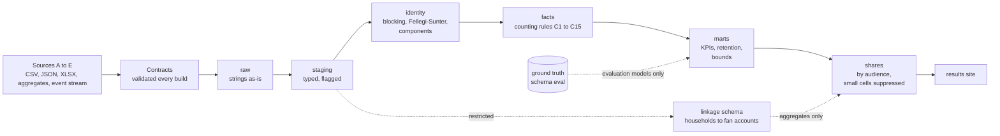

# Counting Flag Football

**[Results site](site/index.html)** (built by `make site`; CI publishes it to GitHub Pages) · [Methodology memo](docs/methodology/counting-a-participant.md) · [Decisions](docs/decisions/) · [Demo script](docs/demo_script.md)

A governed participation data platform for a **synthetic** global flag football program. Five messy sources (a league CSV, a club API, a federation workbook, school headcounts
and a fan feed) go in; out come a count of how many people play, how sure we are of it, who stays, and what registering a child does to a household's engagement, each graded
against an answer key the generator keeps. Python generates and loads; **SQL (dbt on DuckDB) is the showcase**.

> ## All data in this project is synthetic
> Every person, email and phone number is fake, generated from a fixed seed (42). The real equivalent is **minors' personal information**: children aged 5 to 17, their
> guardians' contact details, photo and marketing consent. That is why the project uses invented people: the modelling, privacy and governance patterns can be shown in public
> without exposing a real child. Every number below describes a generated population, not a real program.

## Architecture



## Results (synthetic data, 2021 to 2025; 2025 shown)

| What | Result |
|---|---|
| Unique registered participants | 8,959 in 2025 (identity range 8,921 to 8,976, a 0.6% band) |
| Identity resolution, final matcher (`fs`, automatic merges) | precision 99.81%, recall 99.99%; **9 sibling/twin false merges (a finding, not yet fixed: ADR-008)**; 14,991 predicted vs 15,000 true people |
| Rules baseline vs probabilistic | rules recall 92.7% (16,044 predicted people, no sibling merges); literal Fellegi-Sunter `fs_naive` makes 213 sibling merges; the corrected `fs` makes 9 |
| One-year retention of entrants (Kaplan-Meier, censored) | 72.2%; counting age-outs as churn would report 37% for entrants aged 14 to 17 (truth 61%) |
| Fan engagement uplift after first registration | naive +30.4% (1.7x the truth), matched difference-in-differences +21.0% (truth +18.2%) |
| Household link rate (registration to fan account) | 36% overall; email links 100% precise, phone links 88% |

Counts are **registered participants in onboarded sources**, not total participation. Details and caveats: the [methodology memo](docs/methodology/counting-a-participant.md) (prose still
being written), [phase 2 results](docs/phase2_results.md), and the [results site](site/index.html).

## Design decisions

| ADR | One line |
|---|---|
| [001 Stack](docs/decisions/ADR-001-stack.md) | dbt-duckdb, with every DuckDB-specific function logged so a Snowflake port is a list, not a hunt |
| [002 Age cutoff](docs/decisions/ADR-002-age-cutoff-convention.md) | Age is age on December 31 of the season year |
| [003 Identity resolution](docs/decisions/ADR-003-identity-resolution.md) | Blocking plus Fellegi-Sunter in SQL; precision first, because a sibling merge is a privacy incident |
| [004 Participant ID stability](docs/decisions/ADR-004-participant-id-stability.md) | IDs are derived and stable across rebuilds; a persisted registry is the production step |
| [005 Counting rules](docs/decisions/ADR-005-counting-rules.md) | Rules C1 to C15 define who counts, once, in which country, at what age |
| [006 Privacy controls](docs/decisions/ADR-006-privacy-controls.md) | Audience column policy, small-cell suppression, pseudonymization; pseudonymous is not anonymous |
| [007 Publish and restatement](docs/decisions/ADR-007-publish-and-restatement.md) | Immutable snapshots; a changed published number needs a cause, a threshold and an owner |
| [008 Phase 4 scope and findings](docs/decisions/ADR-008-phase-4-scope-and-findings.md) | Config-driven window, contracts and a playbook, aggregate-only sources, and what Phase 4 found |
| [009 Household linkage governance](docs/decisions/ADR-009-household-linkage-governance.md) | Linking registrations to fan accounts is a governance decision; restricted zone, aggregates out. Decided by Anna (2026-10-02) |
| [010 Fandom outcomes](docs/decisions/ADR-010-fandom-outcomes-design.md) | Matched difference-in-differences, designed before the truth was read and never tuned to it |

## If this were real

- **Snowflake and dbt Cloud.** The dbt is written to be portable (DuckDB-only functions are listed in ADR-001); real warehouse roles would replace the policy that a build check enforces.
- **Orchestration.** Scheduled loads, freshness checks and alerting; today everything runs from `make`.
- **Partner contracts as a governance process.** A contract here is a YAML file validated on every build; a real one is signed with the partner, owned by a named role and renegotiated when the data changes (see the [playbook](docs/playbook/onboard-a-source.md)).
- **A persisted participant-ID registry.** IDs here are derived; production needs a registry so that a merge or split is an event, not a rebuild (ADR-004).
- **Real access control.** Column policies per audience, with database roles, audit logging and an access review (ADR-006).
- **Attendance data.** A registration is not proof someone played. Counting attendance would change every definition here.
- **Real data would score lower.** The synthetic population has phone numbers that never change and one nickname list; identity resolution on real data is harder, and the truth column would not exist.

## Run it

Requires [`uv`](https://docs.astral.sh/uv/) and `make`. Python 3.11 to 3.13 is fetched automatically.

```bash
make setup        # install dependencies, create dbt/profiles.yml from the example
make all-phases   # the supported full build, from an empty checkout: about 2.5 minutes
make site         # build the results site into site/ (open site/index.html, or serve the folder)
```

`make all-phases` generates the data, loads raw, ground truth and published snapshots, validates the contracts, runs every dbt model and test, runs pytest, and runs the build
checks: ground-truth isolation, aggregate lineage, share policy and participant-ID stability. Any failure stops it.

| Command | What it does |
|---|---|
| `make generate` / `make load` / `make load-eval` | write the synthetic files; land them in `raw`; load the quarantined ground truth into `eval` |
| `make contracts` | validate every source contract against the raw tables (an `ERROR` fails the build) |
| `make retention` / `make linkage` / `make fan` | run one Phase 4 analysis and print its comparison with the truth |
| `make docs` | regenerate the data dictionary, metric catalog and access policy |
| `make publish YEAR=2025` | write an immutable snapshot (refuses unless every test passes; never part of `all-phases`) |
| `make site` | build the results site; fails if a chart would compute a number in the browser |

Explore `warehouse/flag.duckdb`:

```sql
select * from share_exec.share_exec__participation_bounds;       -- the headline with identity bounds
select * from quality.dq_summary;                                -- observed vs configured defect rates
select * from retention.mart_retention_survival;                 -- Kaplan-Meier with Greenwood intervals
select * from evaluation.eval_fan_effect;                        -- naive vs matched vs truth
```

## Principles

1. **SQL is the showcase.** Python generates and loads; cleaning, counting, matching and analysis are SQL.
2. **Raw is immutable.** Strings in, strings stored.
3. **Deterministic.** One seed; two clones produce byte-identical files.
4. **Messiness is specified.** Defects are injected at exact counts, so detection can be checked.
5. **Ground truth is quarantined.** It lives in schema `eval` and is read only by `models/evaluation/`; a build check enforces it.
6. **Never guess.** Ambiguity becomes NULL or `U` and is flagged. Consent not captured is NULL, never FALSE.
7. **Say how sure you are.** Identity bounds, censoring, confidence intervals, and a comparison with the naive answer next to every estimate.

## Documents

[Methodology memo](docs/methodology/counting-a-participant.md) · [Changelog](docs/methodology/CHANGELOG.md) · [Metric catalog](docs/metrics.md) · [Access policy](docs/access_policy.md) ·
[Data dictionary](docs/data_dictionary.md) · [Source inventory](docs/source_inventory.md) · [Onboarding playbook](docs/playbook/onboard-a-source.md) ·
[Restatement examples](docs/reports/restatement_demo.md) · [Earlier build notes (phases 1 to 3)](docs/build_notes_phases_1_to_3.md)
