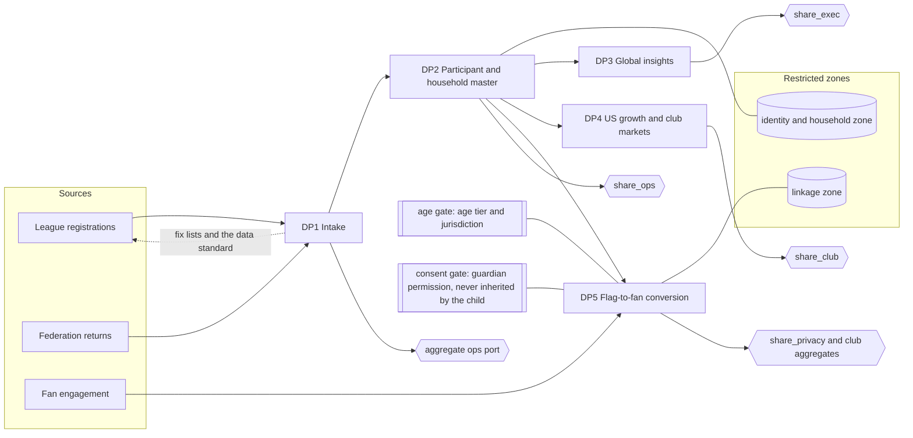

# Reference design: how the products feed each other

An original diagram of this project's own flow. Output ports are the share schemas; the gates are where age and consent rules are applied.

Reading it
- **Arrows between products are dependencies.** DP3, DP4 and DP5 all depend on DP2; DP2 depends on DP1.
- **Dotted line:** DP1 gives something back to the supplier, the fix list and the data standard. That is why a volunteer league has a reason to send the data.
- **Restricted zones** (identity, household, linkage) are never an output port. Only aggregates leave them, through the share schemas.
- **The age gate and the consent gate sit in front of DP5** and anything that activates a household (section 4 of the handover, ADR-022). Analytics on linked households is allowed under the project's household linkage policy (ADR-009); activation is allowed only with the guardian's permission for the purpose.
